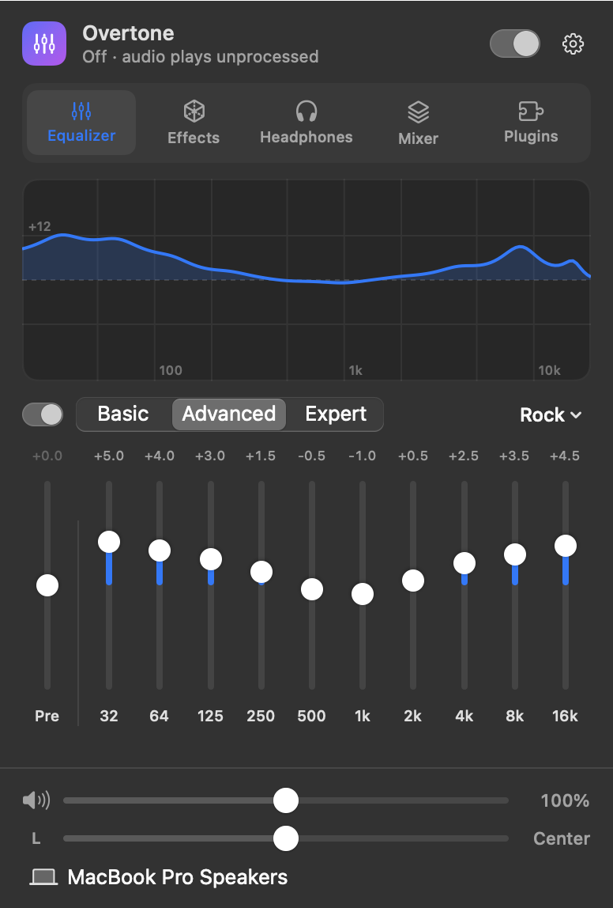
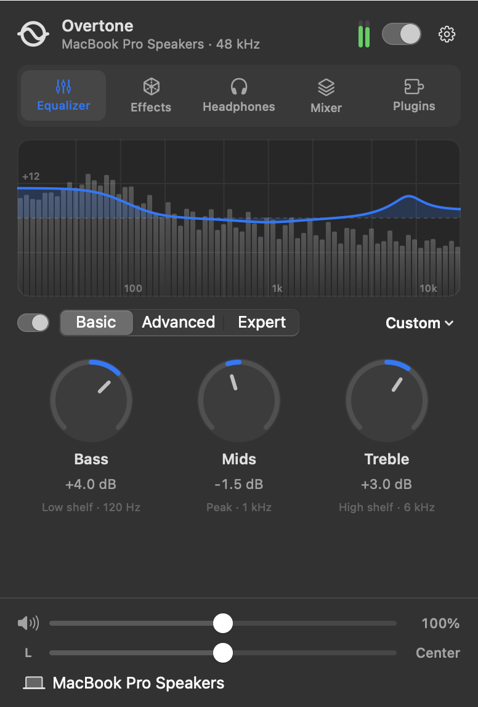
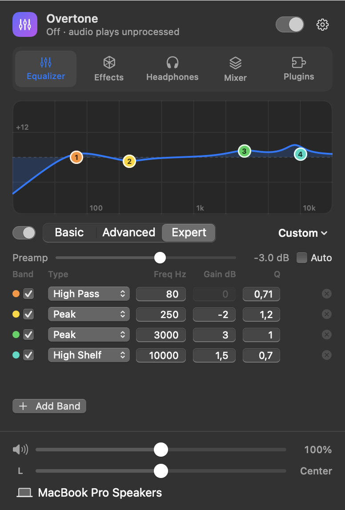
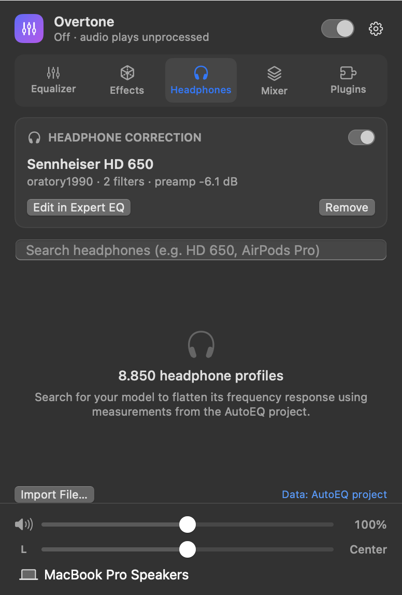
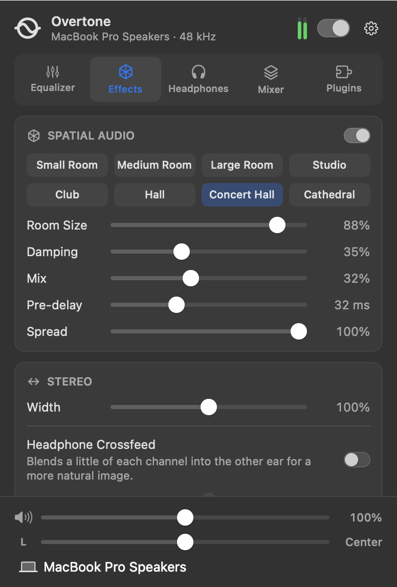
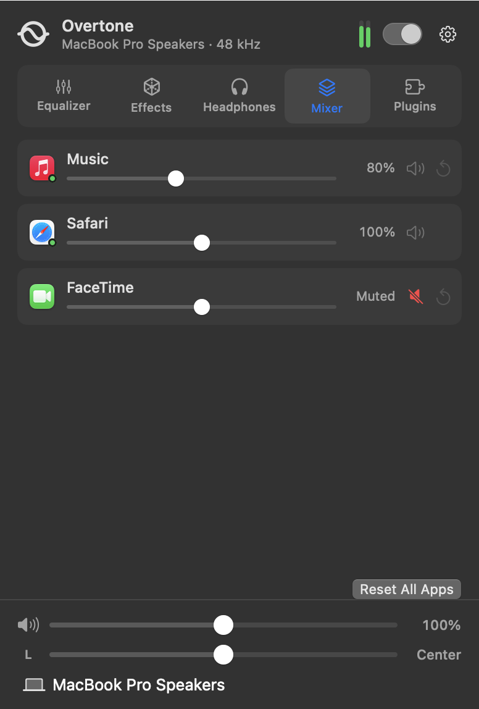
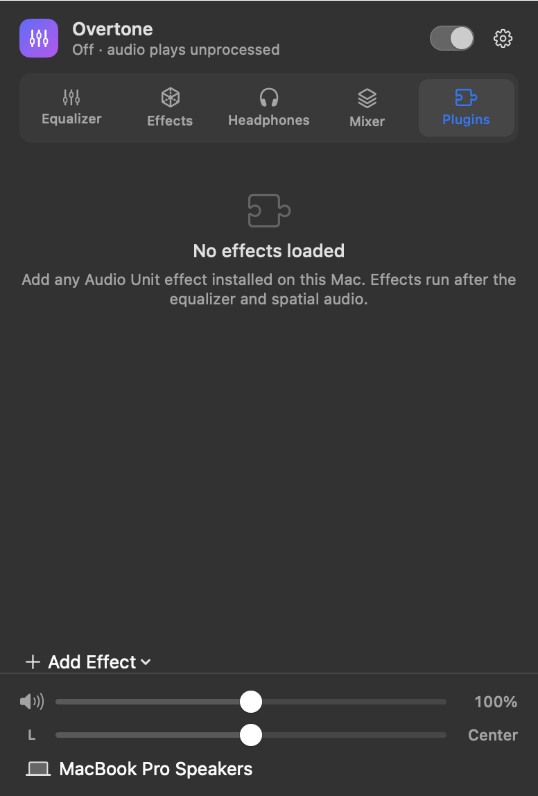

<p align="center">
  
</p>

<h1 align="center">Overtone</h1>

<p align="center">
  <b>A system-wide equalizer for macOS that lives in your menu bar.</b><br>
  Everything <a href="https://github.com/bitgapp/eqMac">eqMac</a> does, every Pro feature included, with no audio driver to install.
</p>

<p align="center">
  
</p>

---

- [Features](#features)
- [Install](#install)
- [First launch](#first-launch)
- [Using Overtone](#using-overtone)
- [Settings](#settings)
- [Tips](#tips)
- [Uninstall](#uninstall)
- [Troubleshooting](#troubleshooting)
- [How it works](#how-it-works)
- [Development](#development)

## Features

- **Three equalizers.** Basic (bass, mids, treble), Advanced (10 bands, 22 classic presets) and
  Expert: up to 32 fully parametric bands you can drag right on the frequency graph.
- **Headphone correction.** Pick your model from 8,800+ measured headphones (AutoEQ) and Overtone
  flattens its response with one click.
- **Spatial audio.** Room simulation from a small room to a cathedral, stereo width, and
  headphone crossfeed.
- **Volume mixer.** Set the volume of each app separately, or mute and boost it.
- **Audio Unit plugins.** Run any Audio Unit effect installed on your Mac on all system audio.
- **Spectrum analyzer.** Watch the live spectrum behind your EQ curve, with output meters.
- **Volume boost and balance.** Go up to 400 % and pan left or right on every output.
  The volume keys can control HDMI and DisplayPort outputs that have no volume of their own.
- **Presets.** Save, import and export presets as JSON or Equalizer APO `ParametricEQ.txt`.
- **Per-device memory.** Your headphones and speakers each keep their own EQ.
- **Clipping protection.** A look-ahead limiter and auto gain.
- **Lightweight.** No Dock icon and no driver. When nothing is playing, Overtone does no audio processing.

| eqMac feature | eqMac Free | eqMac Pro | Overtone |
| --- | :-: | :-: | :-: |
| System audio EQ, volume boost, balance | ✅ | ✅ | ✅ |
| Basic and Advanced EQ | ✅ | ✅ | ✅ |
| Expert parametric EQ | | ✅ | ✅ |
| AutoEQ headphone correction | | ✅ | ✅ |
| Spectrum analyzer | | ✅ | ✅ |
| Spatial audio | | ✅ | ✅ |
| Per-app volume mixer | | ✅ | ✅ |
| Audio Unit hosting | | ✅ | ✅ |
| Custom UI colours and sections | | ✅ | ✅ |

## Install

Overtone needs **macOS 14.4 Sonoma or later** and runs natively on Apple Silicon and Intel Macs.

### With Homebrew (recommended)

```bash
brew install --cask tobiaspol/tap/overtone
```

This adds the [tap](https://github.com/TobiasPol/homebrew-tap), downloads the latest release
and puts `Overtone.app` into your Applications folder. Then open Overtone from Applications or
Spotlight.

> **First launch:** releases aren't notarized by Apple yet, so macOS blocks the very first
> launch with a warning that it can't verify the app. Open **System Settings → Privacy &
> Security**, scroll down and click **Open Anyway** (you only do this once per version).
> If you prefer the terminal: `xattr -dr com.apple.quarantine /Applications/Overtone.app`

Keep it up to date, or remove it:

```bash
brew upgrade --cask overtone           # update to the newest release
brew uninstall --cask overtone         # remove the app
brew uninstall --zap --cask overtone   # remove the app and its settings
```

### Download manually

Download `Overtone-<version>.zip` from the
[latest release](https://github.com/TobiasPol/overtone/releases/latest), unzip it, move
`Overtone.app` to Applications, and allow it once as described above.

### Build from source

You need [Xcode](https://apps.apple.com/app/xcode/id497799835) 16 or later.

```bash
git clone https://github.com/TobiasPol/overtone.git
cd overtone
scripts/build-app.sh
```

This creates `build/Overtone.app`. Move it into your Applications folder:

```bash
ditto build/Overtone.app /Applications/Overtone.app
open /Applications/Overtone.app
```

#### Optional: sign with your developer certificate

By default the app is signed ad hoc, which is fine for your own Mac. But each rebuild then looks
like a new app to macOS, and it asks for the audio permission again. If you have an Apple
developer certificate, copy `.env.example` to `.env` and set your identity:

```bash
security find-identity -v -p codesigning        # list your identities
```

```dotenv
CODESIGN_IDENTITY=Apple Development: Your Name (TEAMID)
```

Builds signed with a certificate keep the permission across rebuilds and use the hardened runtime.

## First launch

1. **Find the icon in the menu bar.** It's a circle crossed by a wave:

   

   A small dot on the icon means Overtone needs your attention (see [Troubleshooting](#troubleshooting)).
   If your menu bar is crowded, the icon may be hidden behind the notch. Quit a few menu bar apps
   or use a menu bar manager.

2. **Allow audio access.** macOS asks whether Overtone may record this computer's audio. Click
   **Allow**. Overtone only reads your system sound to process it, and nothing leaves your Mac.
   If you clicked *Don't Allow*, enable Overtone under **System Settings → Privacy & Security →
   Screen & System Audio Recording**, then click **Try Again** in Overtone's window.

3. **Play something.** The header shows your output device and sample rate, and the level meter
   moves. You're done.

4. *(Optional)* Open **Settings** (gear icon) and turn on **Open Overtone at login**.

## Using Overtone

Click the menu bar icon to open Overtone. The window has four parts:

| Part | What it does |
| --- | --- |
| **Header** | The switch turns all processing on or off. Off means your Mac plays sound exactly as if Overtone weren't running. The status line shows the output device; the meter shows the output level. |
| **Tabs** | Equalizer, Effects, Headphones, Mixer and Plugins. You can hide tabs you don't use in Settings. |
| **Section** | The controls for the selected tab. |
| **Footer** | Overtone volume (with boost), balance and the output device. These are always visible. |

### Equalizer

<p>
  
  
</p>

Choose a mode with **Basic / Advanced / Expert**. The small switch to its left bypasses the EQ.

- **Basic:** three knobs for bass, mids and treble. Drag up or down to turn a knob.
- **Advanced:** a 10-band graphic EQ from 32 Hz to 16 kHz, plus a preamp (**Pre**) to make
  room for boosts.
- **Expert:** a parametric EQ. Each band has a type (peak, low/high shelf, low/high pass, band
  pass, notch or all-pass), a frequency, a gain and a Q (width). Drag the numbered handles on
  the graph to move a band, or type exact values. **Add Band** places a new band in the
  emptiest part of the spectrum. Tick **Auto** to lower the preamp automatically so boosts never
  clip.

The graph shows the combined response of your EQ and any headphone correction, over the live
spectrum of what's playing.

**Presets.** Open the menu on the right (it shows the preset name, *Custom*, or *(edited)*):

- Pick any built-in preset or one of your own.
- **Save Preset…** stores the current settings for this mode. Saving under an existing name
  replaces that preset.
- **Delete** removes the selected preset (your own presets only).
- **Import Preset…** accepts Overtone JSON files and Equalizer APO / AutoEQ `ParametricEQ.txt` files.
- **Export** saves your presets for the current mode, or the whole active curve as a
  `ParametricEQ.txt` you can use in other apps.

### Headphones



Headphones don't sound neutral out of the box. [AutoEQ](https://github.com/jaakkopasanen/AutoEq)
publishes corrections measured for thousands of models.

1. Type your model into the search field, for example `HD 650` or `AirPods Pro`.
2. Click a result. Overtone downloads the correction and turns it on.
3. Use the switch on the correction card to compare with and without it.

The correction runs before your own EQ, so you can keep using presets on top of it. **Edit in
Expert EQ** copies the correction's filters into Expert mode so you can fine-tune them band by
band. **Import File…** loads a `ParametricEQ.txt` you already have.

With **Remember EQ per output device** enabled (the default), each device keeps its own
correction. Plugging in your headphones brings their correction back automatically.

<br clear="right">

### Effects



- **Spatial Audio** places the music in a virtual room. Pick an environment (Small Room through
  Cathedral), then shape it with **Room Size**, **Damping** (how quickly highs fade), **Mix**,
  **Pre-delay** and **Spread**.
- **Stereo → Width** narrows the image toward mono (0 %) or widens it (up to 200 %).
- **Headphone Crossfeed** blends a little of each channel into the other ear. Hard-panned
  recordings then sound less "inside your head".
- **Protection → Limiter** catches peaks before they distort. Keep it on when you boost.
  **Auto Gain** lowers the preamp by the EQ's highest boost.

<br clear="right">

### Mixer



Every app that's playing sound appears here (a green dot means it's playing right now).

- Drag an app's slider to set its volume, from silent to 200 %.
- Click the speaker to mute just that app.
- Click ↺ to return an app to normal.

Apps you've adjusted stay in the list while they're running, and Overtone remembers their volume
for next time. The mixer needs Overtone to be switched on.

<br clear="right">

### Plugins



Add any Audio Unit effect installed on your Mac (Apple's built-in effects, or third-party
compressors, reverbs and so on) and it runs on all system audio:

1. Click **Add Effect** and choose a plugin by manufacturer.
2. Click the slider icon to open the plugin's own window.
3. Use the switch to bypass a plugin. The **…** menu moves it up or down, or removes it.

Plugins run in order, after the EQ and spatial effects. Their settings are saved. If a plugin
can't load (for example after it was uninstalled), its row says *Unavailable*, with **Retry**
and **Remove** buttons.

<br clear="right">

### Volume, balance and output

- **Volume** is Overtone's own gain. It goes from 0 to 200 % by default; raise the maximum in
  Settings (up to 400 %). It snaps to 100 %, and the percentage turns orange while you're boosting.
  Your Mac's volume keys still control the device's hardware volume as usual.
- **Balance** pans between left and right. It snaps to the centre; double-click the value to
  re-centre.
- **Output device** switches where your Mac plays sound (the same as Control Center), and
  Overtone follows automatically. It also follows when you connect headphones or pick a device
  elsewhere.

## Settings

Open them from the gear menu, or right-click the menu bar icon.

| Tab | Options |
| --- | --- |
| **General** | Open at login. Remember EQ and headphone correction per output device. Maximum volume boost. Use the volume keys for outputs without volume control (needs Accessibility permission; Overtone shows a **Grant Access…** button). |
| **Interface** | Accent colour. Show or hide the spectrum analyzer. Which tabs appear in the window. |
| **About** | Version, credits, and **Reset All Settings** (keeps your presets and plugins). |

## Tips

- **Right-click** the menu bar icon for a quick **Turn Overtone Off/On**, **Settings** or **Quit**.
- **Double-click** any EQ slider, knob or effect label to reset it.
- **HDMI and DisplayPort** monitors usually have no volume control. Turn on *Use volume keys…*
  in Settings and your volume keys will drive Overtone's volume instead, with an on-screen
  indicator.
- **Compare quickly** with the header switch. Off is a true bypass.
- To pass your settings to another Mac, export presets from the preset menu and import them there.

## Uninstall

Installed with Homebrew? `brew uninstall --zap --cask overtone` removes the app and its settings.
Afterwards, reset the audio permission with the `tccutil` line below.

Otherwise:

1. Turn off **Open Overtone at login** in Settings, if you enabled it.
2. Quit Overtone (right-click the icon → **Quit Overtone**).
3. Remove the app, its settings, and the audio permission:

```bash
rm -rf /Applications/Overtone.app
rm -rf ~/Library/Application\ Support/Overtone
tccutil reset AudioCapture com.tobiaspol.overtone
```

Overtone installs nothing else: no driver, no launch daemon, no kernel extension.

## Troubleshooting

**The icon has a dot, or the window shows a warning.** Read the message in the window:

- *System audio recording is not allowed*: enable Overtone in **System Settings → Privacy &
  Security → Screen & System Audio Recording**, then click **Try Again**.
- *… didn't start processing*: this output can't be used for processing. AirPlay devices are
  the usual cause. Your sound keeps playing normally, without effects. Choose another output, or
  click **Retry**.

**macOS says it can't verify Overtone, or that it's damaged.** Releases aren't notarized yet.
Allow it once under **System Settings → Privacy & Security → Open Anyway**, or run
`xattr -dr com.apple.quarantine /Applications/Overtone.app`.

**macOS asks for permission again after every build or update.** That happens with ad hoc signing. Sign
with your developer certificate (see [Install](#optional-sign-with-your-developer-certificate)).

**Sound distorts when I boost.** Turn on the **Limiter** (Effects tab), lower the preamp, or
tick **Auto** / **Auto Gain**.

**The volume keys do nothing on my monitor.** Turn on *Use volume keys…* in Settings and grant
Accessibility access when asked (**System Settings → Privacy & Security → Accessibility**).

**AutoEQ search shows an error.** The headphone list is downloaded once and then cached. Check
your internet connection and click **Try Again**.

**Something sounds wrong and I want a clean start.** Settings → About → **Reset All Settings**.
If Overtone ever misbehaves, quitting it instantly returns your Mac to normal audio.

**Reporting a bug?** The audio engine log helps a lot:

```bash
/usr/bin/log stream --predicate 'subsystem == "com.tobiaspol.overtone"' --level info
```

## How it works

eqMac routes your audio through a virtual driver. Overtone uses **Core Audio process taps**,
added in macOS 14.2, instead:

1. A tap captures every app's sound, except Overtone's own, and mutes the original while
   Overtone reads it. Apps with a custom mixer volume get their own tap.
2. A private aggregate device pairs those taps with your real output device.
3. A real-time engine written in C processes the audio: EQ, spatial effects, plugins, volume
   and limiter. It then plays the result on that same device.

Nothing is installed in the system. If Overtone quits or crashes, macOS unmutes the apps
immediately. Details are in [docs/ARCHITECTURE.md](docs/ARCHITECTURE.md).

## Development

```bash
swift build                  # debug build
swift test                   # unit tests (DSP, IO proc, parsers, settings)
scripts/check.sh             # all quality gates: warning-free build, tests, size limits, secret scan
scripts/run.sh               # build a debug app bundle and launch it
scripts/install-hooks.sh     # run the quality gates before every commit
scripts/make-artwork.sh      # regenerate the app icon and README images from the logo source
scripts/package-release.sh 1.1.0   # universal release zip + SHA-256 in build/
.build/debug/Overtone --snapshot docs/screenshots   # re-render the README screenshots
```

### Releasing

1. Push a version tag:

   ```bash
   git tag v1.1.0 && git push origin v1.1.0
   ```

2. The **Release** workflow tests the code, builds a universal app
   (`scripts/package-release.sh`) and publishes a GitHub release with the zip and its SHA-256.
3. If the repository has a `TAP_GITHUB_TOKEN` secret (a fine-grained token with *Contents:
   read and write* on `TobiasPol/homebrew-tap`), the workflow also updates the cask. Without
   it, update the cask by hand:

   ```bash
   scripts/update-cask.sh 1.1.0 "$(curl -sL https://github.com/TobiasPol/overtone/releases/download/v1.1.0/Overtone-1.1.0.zip.sha256)" ../homebrew-tap
   ```

### Build settings

`scripts/build-app.sh` reads these optional settings from `.env` (see `.env.example`).
Variables already set in your environment take precedence:

| Variable | Purpose |
| --- | --- |
| `CODESIGN_IDENTITY` | Signing identity (`-` = ad hoc) |
| `BUNDLE_ID` | Bundle identifier of the built app |
| `VERSION` | Version shown in About |
| `UNIVERSAL` | `1` builds a universal arm64 + x86_64 app |

```
src/OvertoneDSP/   real-time C engine: IO proc, EQ, effects, limiter, plugin chain
src/Overtone/      the app: App/, Audio/ (Core Audio), DSP/, Models/, Presets/, AutoEQ/,
                   Mixer/, Plugins/, System/, UI/ (SwiftUI)
tests/             Swift Testing suites
scripts/           build, run, artwork and quality-gate scripts
```

## Credits

- Headphone measurements and corrections: [AutoEQ](https://github.com/jaakkopasanen/AutoEq) by Jaakko Pasanen
- Room simulation based on Jezar's public-domain Freeverb
- Filter design from Robert Bristow-Johnson's *Audio EQ Cookbook*
- Inspired by [eqMac](https://github.com/bitgapp/eqMac). Overtone is an independent project and
  shares no code with it.
